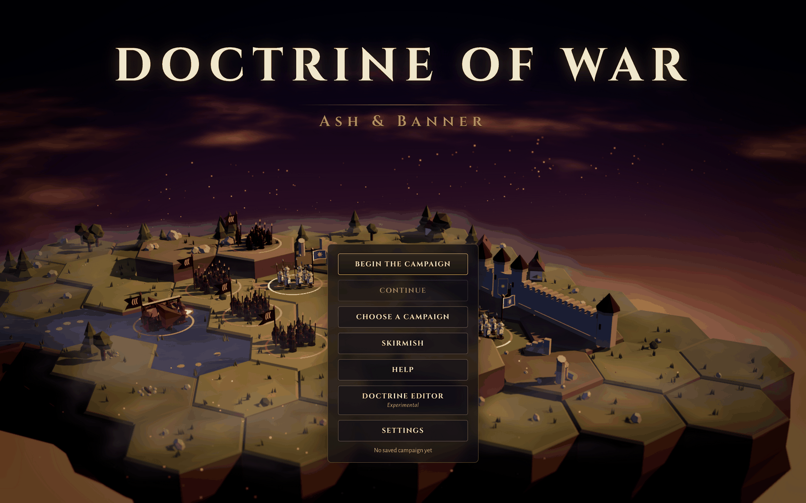
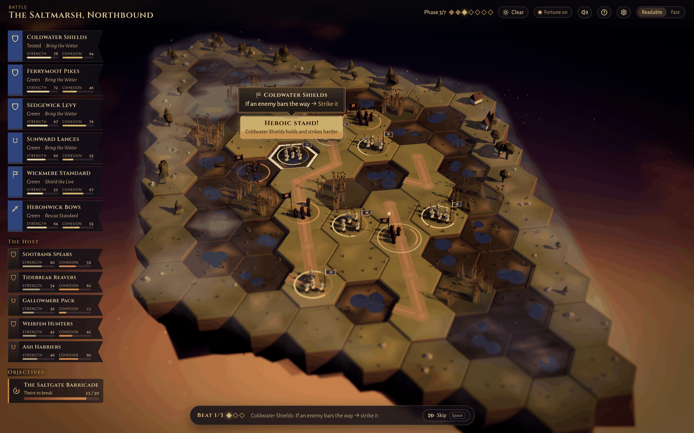
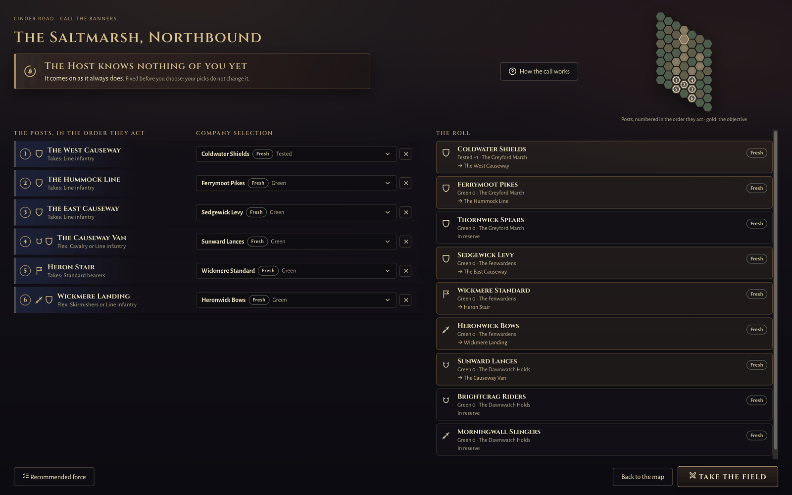
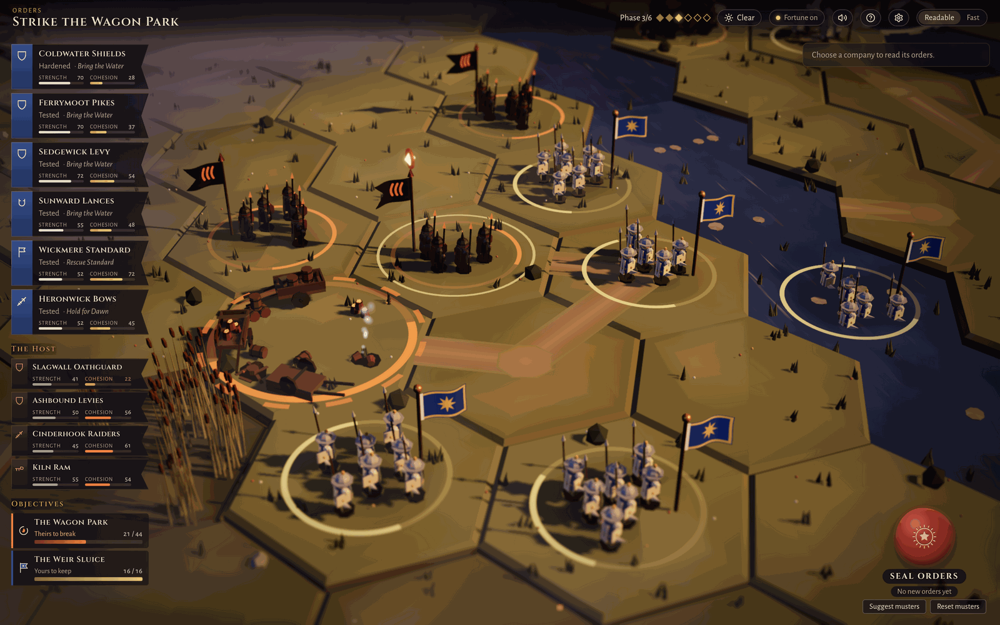
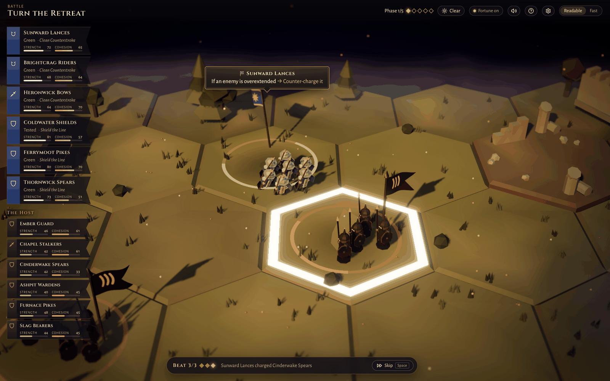
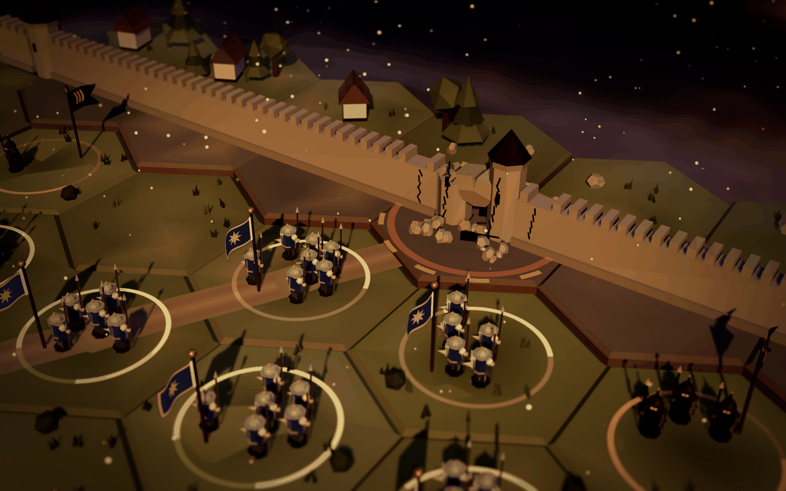

# Doctrine of War: Ash & Banner

**A fantasy command game where you never move a soldier.** You write your companies' standing
orders (their *doctrines*), seal them, and watch the battle play out on a floating-island
diorama. Then you read the chronicle, see which orders fired, and write better ones.



<p>
  <a href="https://doctrinegame.ftlenterprises.us"><strong>▶ Play in your browser</strong></a>
  &nbsp;·&nbsp;
  <a href="https://github.com/fyzycyst/Doctrine_of_War/releases"><strong>⬇ Download for Mac</strong></a>
</p>

Version 1.0.0 · © 2026 FTL Enterprises

## The game

The Ashen Host is coming down the road. You command the Free Banners, a handful of companies of
line infantry, cavalry, skirmishers and standard bearers. Each phase you give every company a
doctrine card: a short list of *if this, then that* rules, read top to bottom. Seal your orders and
the phase plays out in three beats, the Host first and then your companies, each one following the
first rule that fits. Fortune is real but always shown, fog hides what your companies can't see, and
a company breaks when its cohesion reaches zero, however much strength it has left.

| | |
| --- | --- |
|  |  |
|  |  |
|  | |

### Two campaigns, and Skirmish

- **Ash & Banner**: the defence of Greyford, in four battles, with a fixed army whose companies
  carry their Resolve and renown from battle to battle: *The First Breach*, *Ember Ford*, *The
  Saltmarsh Column* and *Hold for Dawn*. The first battle teaches the game as you play.
- **Cinder Road**: the counter-offensive, in five battles. Before each one you **Call the Banners**:
  choose which company holds each post, from a Roll of companies that tire (Fresh, Worn,
  Reforming) and rest in reserve. Up to five veterans can come from a completed Ash & Banner, and at
  most two take the field in any battle. *The Saltmarsh, Northbound*, *Strike the Wagon Park*,
  *Open a Road*, *Turn the Retreat*, *Break the Strongpoint*.
- **Skirmish**: any battle of either campaign again, on a fresh fortune, with the battle's default
  forces (all fresh, no veterans). Nothing is saved.

Also in the box: a **doctrine editor** (reorder and tune a doctrine's rules, then *Test in the field*
against the original over many battles), and an in-game **Field Manual** (press `F1` or `?`).

## Play

| | |
| --- | --- |
| **In a browser** | <https://doctrinegame.ftlenterprises.us>. A modern desktop browser with **WebGL 2** (current Chrome, Edge, Firefox or Safari). Saves stay in that browser. |
| **On a Mac** | The DMG from [the releases page](https://github.com/fyzycyst/Doctrine_of_War/releases): one for **Apple silicon** (arm64) and one for **Intel** (x64), on a recent version of macOS. Signed and notarized. Saves go to `~/Library/Application Support/Doctrine of War/`. |

## Controls

Everything is mouse-driven, and the keyboard works throughout. The same table is the Field
Manual's Controls page (`src/app/shortcuts.ts`; a test keeps this copy in step).

| Keys | Does | Where |
| --- | --- | --- |
| `F1` or `?` | Open the Field Manual | Anywhere (outside a text box) |
| `Esc` | Close the top layer (a guide, a dialog, the hand), then deselect the company | Battle: deploying and giving orders |
| `Space` or `Esc` | Skip to the end of the phase | Battle: while a phase plays |
| `↑` or `↓` | Move between companies | Battle: the company list |
| `Enter` or `Space` | Select the company (when giving orders, open its hand of doctrines) | Battle: the company list |
| `←` or `→` or `Home` or `End` | Browse the doctrines | Battle: the hand of doctrines |
| `Enter` or `Space` | Give the company that doctrine | Battle: the hand of doctrines |
| `Esc` | Back to the company list | Battle: the hand of doctrines |
| `↑` or `↓` | Move between companies | Call the Banners: a post's company list |
| `Esc` | Close the list, or the help | Call the Banners: a post's company list, or How the call works |
| `Esc` | Skip the guide | The first battle's guide |
| `⌘/Ctrl ⇧ H` | Capture mode: hide the interface for a clean picture (again to bring it back) | Anywhere |

## Run it locally

Requires Node.js 20.19 or later (or 22.12+), as Vite 7 does.

```bash
npm ci
npm run dev        # the web build at the URL Vite prints
npm run dev:mac    # the Electron app (see the npm 11 note below)
```

**npm 11:** its install-scripts policy skips Electron's postinstall, so the Electron binary is never
downloaded. After `npm ci`, run `node node_modules/electron/install.js` once.

### Tests and builds

```bash
npx tsc -b             # type-check every project
npm test               # fast: unit, UI and engine tests
npm run test:balance   # simulation-heavy: each battle's balance smoke, role sweeps, ablations
npm run test:campaign  # the heaviest campaign sweeps
npm run build          # the web build (dist/)
npm run build:mac      # the Mac DMGs (release/); signing and notarizing: docs/RELEASE.md
```

Which suite a test file runs in is set by its name (`src/test/suites.ts`); see "Test suites" in
[docs/CAMPAIGN.md](docs/CAMPAIGN.md). The engine's rules are in [docs/ENGINE.md](docs/ENGINE.md),
and how a battle is balanced and signed off is in docs/CAMPAIGN.md.

### Developer tools

- `/?lab=1` on the dev server opens the Look Lab, a diorama test bench (`src/render/README.md`).
- `npm run capture:app [-- <filter>]` screenshots the app at 1600×1000 and 1280×800 into
  `captures/` (gitignored), and `npm run capture` does the same for the Look Lab.
- `npm run balance -- --seeds 500` runs a battle's balance gate.
- **Benign Electron log lines on macOS.** `npm run dev:mac` may print Chromium's
  `SetApplicationIsDaemon … paramErr (-50)` and `SharedImageManager::ProduceSkia … non-existent
  mailbox`. Both are Chromium's own and nothing in the game depends on them.

## Credits and licences

Every third-party asset the game ships with is listed in [CREDITS.md](CREDITS.md), and in the game
under Field Manual → About & credits.

| What | By | Licence |
| --- | --- | --- |
| Orchestral samples: Versilian Studios Chamber Orchestra 2, Community Edition (VSCO 2 CE) | Versilian Studios | CC0 1.0 |
| Sound effects: Impact Sounds, Casino Audio, RPG Audio | Kenney | CC0 1.0 |
| Typefaces: Cinzel and Alegreya Sans (via Fontsource) | The Cinzel / Alegreya Sans Project Authors | SIL Open Font License 1.1; the licence texts ship in `licenses/` |
| three.js, React, React Three Fiber, drei, zustand | their authors | MIT |
| postprocessing | Raoul van Rüschen | zlib |
| Lucide icons | Lucide contributors | ISC |
| Electron (the Mac app) | OpenJS Foundation and contributors | MIT |
| Their dependencies (troika, three-stdlib, camera-controls, MediaPipe Tasks, hls.js, …) | their authors | MIT, ISC, Apache-2.0 |

Every bundled package and its licence text is in `licenses/THIRD_PARTY_NOTICES.txt`, which each
production build writes from its own module list (`scripts/thirdPartyNotices.ts`); the fonts'
OFL texts sit beside it. Both ship in the web build and the Mac app.

The terrain, figures, effects, ambience and score are made in code: there are no third-party
models, textures or music recordings in the shipped game.

## How it was built

One person designed and directed it. A team of AI agents built it, each with its own lane: the
engine, the rendering, the interface, and independent review. They worked from written tickets and
reports, each change landing on its own branch with its own tests before it was merged. The project
history, tickets and the design documents in `docs/` show how.

---

© 2026 FTL Enterprises. The game's name, world and writing are original; the third-party pieces
above are under their own licences.
